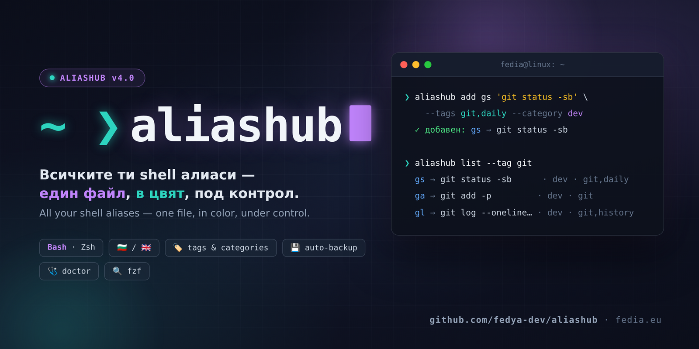
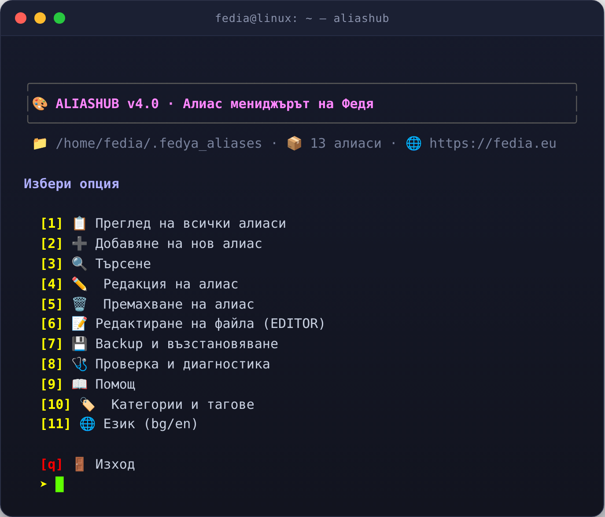
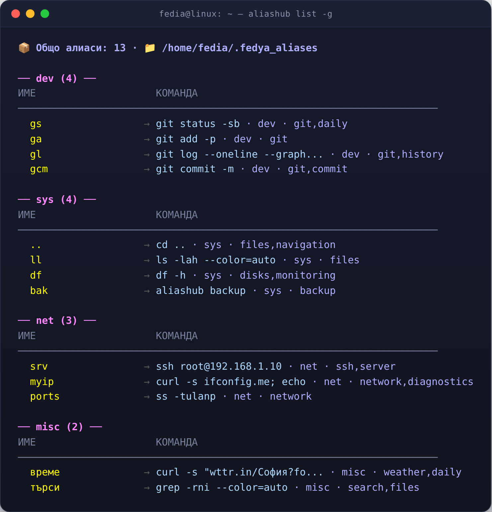
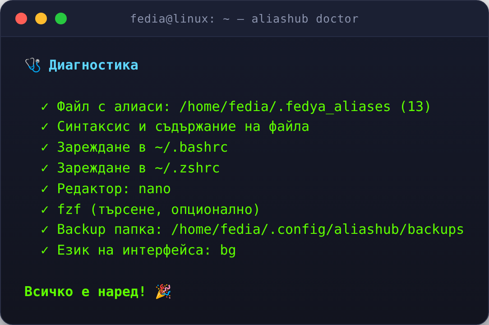

<div align="center">



# 🎨 aliashub

**Алиас мениджърът на Федя — за Bash и Zsh**
*The alias manager for Bash & Zsh — colorful interactive menu, full CLI, categories & tags*


**[🇧🇬 Български](#български) · [🇬🇧 English](#english)**

</div>

---

<a id="български"></a>

## 🇧🇬 Български

**aliashub** пази всички твои shell алиаси в един файл (`~/.fedya_aliases`) и дава два начина за работа с тях: **цветно интерактивно меню** за ежедневната работа в терминала и **CLI подкоманди** (`aliashub add …`, `aliashub rm …`) за скриптове и навик „като git". Всичко, което записва, е валиден Bash **и** Zsh код — дори команди с апострофи, кавички, `|`, `$` и обратни кавички се записват безопасно.

Файлът си остава твой: може да съдържа **собствени функции** (вкл. с имена на кирилица), `if` блокове, export-и и коментари — aliashub управлява само алиас-редовете и не пипа нищо друго. Преди **всяка** промяна се прави автоматичен backup, имената се валидират, дубликатите се отхвърлят, а `doctor` следи дали алиасите изобщо се зареждат във вашите терминали.

<div align="center">

<p><sub>Интерактивното меню · The interactive menu</sub></p>
</div>

### ✨ Възможности

- 🎨 **Цветно интерактивно меню** — всичко на един екран: преглед, добавяне, търсене, backup, диагностика.
- ⌨️ **Пълноцен CLI** — 20+ подкоманди с предвидими имена и exit кодове (0/1/2), удобно за скриптове.
- 🏷️ **Категории и тагове** — групирай алиасите по projects/теми, филтрирай с `list --tag` / `list --category`, виж статистика.
- 🔍 **Умен `check`** — реален синтактичен анализ (`bash -n`), дубликати, нецитирани стойности — без фалшиви тревоги.
- 🩺 **`doctor`** — здравна проверка: файл, синтаксис, `.bashrc`/`.zshrc`, редактор, fzf, backup папка, език.
- 🌐 **Двуезичен интерфейс (bg/en)** — `aliashub lang en` запомня избора трайно; работи и с `LANG`/`LC_ALL`.
- ✍️ **Имена с кирилица и точки** — `alias списък=…`, `alias ..='cd ..'` — всичко, което Bash приема, приема и aliashub.
- 💾 **Автоматичен backup** преди всяка промяна + ръчни backup-и и възстановяване с една команда.
- 🔁 **Миграция от aliasctl v3.x** — старите блокове в rc файловете, backup папката и бинарьният файл се надграждат автоматично.
- 🚫 Уважава `NO_COLOR` · работи без fzf, но го използва, ако го има · без зависимости освен Bash 3.2+.

### 🚀 Инсталация

```bash
git clone https://github.com/fedya-dev/aliashub.git
cd aliashub
./install.sh              # инсталира в ~/.local/bin + настройва авто-зареждане
./install.sh --uninstall  # чисто премахване (алиасите и backup-ите остават)
```

Инсталаторът копира изпълнимия файл в `~/.local/bin/aliashub`, добавя папката в `PATH` (ако липсва), вмъква блок за авто-зареждане в `~/.bashrc` и `~/.zshrc`, пренася backup-ите от `~/.config/aliasctl/` (ако има такива) и накрая пуска `doctor`, за да видиш, че всичко е наред.

Ръчна инсталация (алтернатива):

```bash
chmod +x aliashub && mkdir -p ~/.local/bin && cp aliashub ~/.local/bin/
aliashub init             # добавя source-реда в .bashrc/.zshrc
```

> Изисквания: Bash 3.2+ (Linux, macOS, WSL). Опционално: `fzf` за интерактивно търсене с избор.

### ⚡ Бърз старт

```bash
aliashub                       # интерактивното меню
aliashub add gs 'git status'   # нов алиас
aliashub add psgrep 'ps aux | grep -i '   # сложни команди? без проблем
aliashub add .. 'cd ..'        # точки и тирета също
aliashub add списък 'ls -la'   # и кирилица в имената
aliashub list                  # преглед
aliashub show gs               # един алиас
aliashub rename gs gitstatus   # преименуване
aliashub rm gs                 # изтриване (с backup предварително)
```

> ⚡ След добавяне на алиас той е наличен във **всеки нов терминал**. В текущия: `source ~/.fedya_aliases`.

### 🏷️ Категории и тагове

Всеки алиас може да има една **категория** и много **тагове**. Метаданните се пазят като коментар-ред точно над алиаса — файлът си остава чист и валиден shell код:

```bash
# @aliashub tags=ssh,server category=админ
alias srv='ssh root@srv'
```

```bash
aliashub add srv 'ssh root@srv' --category админ --tags ssh,server
aliashub tag srv net,tunnel        # смени таговете
aliashub tag srv                   # покажи таговете
aliashub category srv админ        # смени категорията
aliashub list --tag ssh            # само алиасите с таг ssh
aliashub list --category админ     # само категория „админ"
aliashub list -g                   # групирано по категория
aliashub search ssh                # търси и в таговете/категориите
aliashub stats                     # статистика по категории
```

<div align="center">

</div>

В менюто: **[10] Категории и тагове** — показва категориите с брой алиаси и всички тагове; избираш категория (номер) или таг (текст), после самия алиас и действие (редакция/тагове/категория/изтриване). При **добавяне** (2) и **редакция** (4) също можеш да зададеш категория и тагове.

### 📖 CLI справочник

| Команда | Какво прави |
|---|---|
| *(без аргументи)* / `menu` | интерактивното меню |
| `list [--raw] [--tag Т] [--category К] [-g]` | преглед; `--raw` връща редовете за `source`; `-g` групира по категория |
| `add ИМЕ КОМАНДА… [--tags а,б] [--category к]` | добавя алиас (валидация + backup + конфликт-проверки) |
| `rm ИМЕ` | изтрива алиас с потвърждение |
| `rename СТАРО НОВО` | преименува (метаданните се запазват) |
| `setcmd ИМЕ КОМАНДА…` | сменя командата на алиас |
| `show ИМЕ` | показва алиаса с таговете и категорията |
| `search [ТЕРМ]` | търси в имена, команди, тагове и категории; без ТЕРМ + fzf = интерактивен избор |
| `tag ИМЕ [ТАГОВЕ]` | показва/задава/изчиства тагове |
| `category ИМЕ [КАТЕГОРИЯ]` | показва/задава/изчиства категория |
| `lang [bg\|en]` | показва/задава езика на интерфейса |
| `edit` | отваря файла в `$EDITOR`/`$VISUAL` (после авто-check) |
| `backup` / `backups` / `restore [N\|FILE\|last]` | backup създаване/списък/възстановяване |
| `check` | валидира файла: синтаксис (`bash -n`), дубликати, невалидни имена, нецитирани стойности, метаданни |
| `doctor` | здравна проверка: файл, синтаксис, rc файлове, редактор, fzf, backup папка, език |
| `init` | добавя авто-зареждане в `.bashrc`/`.zshrc` (идемпотентно; надгражда стари aliasctl блокове) |
| `stats` / `file` / `version` / `help` | статистика, път до файла, версия, помощ |

Exit кодове: `0` успех · `1` грешка при операция · `2` грешна употреба.

### 🩺 Проверка и диагностика

```bash
aliashub check     # само файла: синтаксис, дубликати, имена, метаданни
aliashub doctor    # цялата среда: файл, rc файлове, редактор, fzf, backups, език
```

<div align="center">

</div>

### 🌐 Език (БГ / EN)

```bash
aliashub lang             # текущият език
aliashub lang en          # английски — запазва се трайно в ~/.config/aliashub/config
aliashub lang bg          # обратно на български
LANG=en aliashub list     # временно, за една команда
```

Приоритет: `ALIASHUB_LANG` → конфиг файл → `LC_ALL`/`LC_MESSAGES`/`LANG` → `bg`.

### 💾 Backup и възстановяване

Преди **всяка** промяна (add/rm/rename/setcmd/tag/category/restore) aliashub прави timestamp backup. Ръчно:

```bash
aliashub backup            # backup сега
aliashub backups           # списък (най-новите първи)
aliashub restore last      # възстановява последния
aliashub restore 2         # втория от списъка
```

При `restore` текущият файл също се архивира — възстановяването само по себе си е безопасно.

### ⚙️ Конфигурация

| Променлива | По подразбиране | Описание |
|---|---|---|
| `ALIASHUB_LANG` | от конфиг / `LANG` | език на интерфейса: `bg` / `en` |
| `ALIASHUB_FILE` | `~/.fedya_aliases` | къде живеят алиасите |
| `ALIASHUB_BACKUP_DIR` | `~/.config/aliashub/backups` | папка за backup-и |
| `ALIASHUB_MAX_BACKUPS` | `50` | колко backup-а да се пазят (старите се трият) |
| `NO_COLOR` | – | изключва цветове (стандарт no-color.org); има и флаг `--no-color` |

Траен конфиг: `~/.config/aliashub/config` — засега ключ `lang=bg|en` (записва се от `aliashub lang`).

### 🔁 Миграция от aliasctl (v3.x)

Имаш стара инсталация на **aliasctl**? Нищо не се налага да правиш ръчно: пусни `./install.sh` от папката с aliashub. Старият бинарен файл се премахва, блоковете в `.bashrc`/`.zshrc` се надграждат, backup-ите се пренасят от `~/.config/aliasctl/` в `~/.config/aliashub/`, а променливите `ALIASCTL_*` продължават да се уважават от v4.0 за съвместимост.

### ❓ ЧЗВ

**Добавих алиас, но командата не се намира?**
Носещият шел трябва да прочете файла: `source ~/.fedya_aliases` (или просто отвори нов терминал). `aliashub init` прави това автоматично за всеки нов терминал.

**Мога ли да си пиша функции и коментари в файла?**
Да! Файлът е обикновен shell код — функции (и с имена на кирилица), `if` блокове, export-и, коментари. `check` докладва проблем само за реални грешки; всичко останало не се пипа.

**Мога ли да имам алиас `..` или с кирилица?**
Да. Валидни са всички имена, които Bash приема: `..`, `...`, `git-status`, `списък`… Забранени са само знаци, които чупят реда (интервали, кавички, `$`, `` ` ``, `=` и т.н.).

**fzf е задължителен?**
Не. Без него търсенето работи с класическо съвпадение; с него получаваш интерактивен избор в стила на инструмента.

---

<a id="english"></a>

## 🇬🇧 English

**aliashub** keeps all your shell aliases in a single file (`~/.fedya_aliases`) and gives you two ways to work with them: a **colorful interactive menu** for everyday terminal use and **CLI subcommands** (`aliashub add …`, `aliashub rm …`) for scripts and a git-like workflow. Everything it writes is valid Bash **and** Zsh code — even commands with apostrophes, quotes, `|`, `$` and backticks are stored safely.

The file remains yours: it may contain **your own functions** (Cyrillic names included), `if` blocks, exports and comments — aliashub only manages alias lines and never touches anything else. An automatic backup is taken **before every** change, names are validated, duplicates are rejected, and `doctor` verifies that your aliases are actually loaded by your shells.

### ✨ Features

- 🎨 **Colorful interactive menu** — browse, add, search, backup and diagnose from a single screen.
- ⌨️ **Full CLI** — 20+ subcommands with predictable names and exit codes (0/1/2), script-friendly.
- 🏷️ **Categories & tags** — organize aliases by project/topic, filter with `list --tag` / `list --category`, view stats.
- 🔍 **Smart `check`** — real syntax validation (`bash -n`), duplicates, unquoted values — zero false alarms.
- 🩺 **`doctor`** — health check: aliases file, syntax, `.bashrc`/`.zshrc`, editor, fzf, backup dir, language.
- 🌐 **Bilingual UI (bg/en)** — `aliashub lang en` persists your choice; also honors `LANG`/`LC_ALL`.
- ✍️ **Dots & Cyrillic names** — `alias списък=…`, `alias ..='cd ..'` — anything Bash accepts, aliashub accepts.
- 💾 **Automatic backup** before every change + manual backups and one-command restore.
- 🔁 **Migration from aliasctl v3.x** — old rc blocks, backup dir and binary are upgraded automatically.
- 🚫 Honors `NO_COLOR` · works without fzf but uses it when present · no dependencies beyond Bash 3.2+.

### 🚀 Installation

```bash
git clone https://github.com/fedya-dev/aliashub.git
cd aliashub
./install.sh              # installs to ~/.local/bin + sets up auto-loading
./install.sh --uninstall  # clean removal (aliases and backups are kept)
```

The installer copies the executable to `~/.local/bin/aliashub`, adds that folder to `PATH` (if missing), inserts an auto-load block into `~/.bashrc` and `~/.zshrc`, migrates backups from `~/.config/aliasctl/` (if present) and finally runs `doctor` so you can see everything is fine.

Manual installation (alternative):

```bash
chmod +x aliashub && mkdir -p ~/.local/bin && cp aliashub ~/.local/bin/
aliashub init             # adds the source line to .bashrc/.zshrc
```

> Requirements: Bash 3.2+ (Linux, macOS, WSL). Optional: `fzf` for interactive fuzzy search.

### ⚡ Quick start

```bash
aliashub                       # the interactive menu
aliashub add gs 'git status'   # a new alias
aliashub add psgrep 'ps aux | grep -i '   # complex commands? no problem
aliashub add .. 'cd ..'        # dots and dashes too
aliashub list                  # browse
aliashub show gs               # a single alias
aliashub rename gs gitstatus   # rename
aliashub rm gs                 # delete (backs up first)
```

> ⚡ After adding an alias it is available in **every new terminal**. In the current one: `source ~/.fedya_aliases`.

### 🏷️ Categories & tags

Every alias can have one **category** and many **tags**. Metadata is stored as a comment line right above the alias — the file stays clean, valid shell code:

```bash
# @aliashub tags=ssh,server category=admin
alias srv='ssh root@srv'
```

```bash
aliashub add srv 'ssh root@srv' --category admin --tags ssh,server
aliashub tag srv net,tunnel        # replace tags
aliashub tag srv                   # show tags
aliashub category srv admin        # replace category
aliashub list --tag ssh            # only aliases tagged ssh
aliashub list --category admin     # only the admin category
aliashub list -g                   # grouped by category
aliashub search ssh                # searches names, commands, tags, categories
aliashub stats                     # per-category statistics
```

In the menu: **[10] Categories & tags** — shows categories with alias counts and every tag; pick a category (number) or tag (text), then an alias and an action (edit/tags/category/delete). **Add** (2) and **edit** (4) also accept category and tags.

### 📖 CLI reference

| Command | What it does |
|---|---|
| *(no arguments)* / `menu` | the interactive menu |
| `list [--raw] [--tag T] [--category C] [-g]` | browse; `--raw` prints source-ready lines; `-g` groups by category |
| `add NAME COMMAND… [--tags a,b] [--category c]` | add an alias (validation + backup + conflict checks) |
| `rm NAME` | delete an alias with confirmation |
| `rename OLD NEW` | rename (metadata is preserved) |
| `setcmd NAME COMMAND…` | change an alias's command |
| `show NAME` | show an alias with its tags and category |
| `search [TERM]` | search names, commands, tags and categories; no TERM + fzf = interactive picker |
| `tag NAME [TAGS]` | show/set/clear tags |
| `category NAME [CATEGORY]` | show/set/clear category |
| `lang [bg\|en]` | show/set the UI language |
| `edit` | open the file in `$EDITOR`/`$VISUAL` (auto-check afterwards) |
| `backup` / `backups` / `restore [N\|FILE\|last]` | create/list/restore backups |
| `check` | validate the file: syntax (`bash -n`), duplicates, invalid names, unquoted values, metadata |
| `doctor` | health check: file, syntax, rc files, editor, fzf, backup dir, language |
| `init` | add auto-loading to `.bashrc`/`.zshrc` (idempotent; upgrades old aliasctl blocks) |
| `stats` / `file` / `version` / `help` | statistics, file path, version, help |

Exit codes: `0` success · `1` operation error · `2` usage error.

### 🩺 Health checks

```bash
aliashub check     # the file only: syntax, duplicates, names, metadata
aliashub doctor    # the whole environment: file, rc files, editor, fzf, backups, language
```

### 🌐 Language (BG / EN)

```bash
aliashub lang             # current language
aliashub lang en          # English — persisted in ~/.config/aliashub/config
aliashub lang bg          # back to Bulgarian
LANG=en aliashub list     # temporary, for a single command
```

Priority: `ALIASHUB_LANG` → config file → `LC_ALL`/`LC_MESSAGES`/`LANG` → `bg`.

### 💾 Backup & restore

Before **every** change (add/rm/rename/setcmd/tag/category/restore) aliashub takes a timestamped backup. Manual:

```bash
aliashub backup            # back up now
aliashub backups           # list (newest first)
aliashub restore last      # restore the latest
aliashub restore 2         # restore the second in the list
```

On `restore` the current file is backed up too — restoring is safe by itself.

### ⚙️ Configuration

| Variable | Default | Description |
|---|---|---|
| `ALIASHUB_LANG` | config / `LANG` | UI language: `bg` / `en` |
| `ALIASHUB_FILE` | `~/.fedya_aliases` | where the aliases live |
| `ALIASHUB_BACKUP_DIR` | `~/.config/aliashub/backups` | backup folder |
| `ALIASHUB_MAX_BACKUPS` | `50` | how many backups to keep (old ones are pruned) |
| `NO_COLOR` | – | disable colors (no-color.org standard); also a `--no-color` flag |

Persistent config: `~/.config/aliashub/config` — currently the `lang=bg|en` key (written by `aliashub lang`).

### 🔁 Migrating from aliasctl (v3.x)

Have an old **aliasctl** installation? Nothing to do by hand: run `./install.sh` from the aliashub folder. The old binary is removed, the blocks in `.bashrc`/`.zshrc` are upgraded, backups move from `~/.config/aliasctl/` to `~/.config/aliashub/`, and the `ALIASCTL_*` variables keep working in v4.0 for compatibility.

### ❓ FAQ

**Added an alias but the command is not found?**
The running shell must read the file: `source ~/.fedya_aliases` (or just open a new terminal). `aliashub init` makes that automatic for every new terminal.

**Can I keep my own functions and comments in the file?**
Yes! The file is plain shell code — functions (Cyrillic names included), `if` blocks, exports, comments. `check` only reports real errors; everything else is left untouched.

**Can an alias be `..` or contain Cyrillic?**
Yes. Any name Bash accepts is valid: `..`, `...`, `git-status`, `списък`… Only characters that would break the line are forbidden (spaces, quotes, `$`, `` ` ``, `=`, etc.).

**Is fzf mandatory?**
No. Without it search uses classic matching; with it you get an interactive picker styled like the tool.

---

<div align="center">

**📄 Лиценз / License: MIT** — виж / see [LICENSE](LICENSE)

Създадено с ❤️ от **Федя Серафиев** · още полезни инструменти на 🌐 [**fedia.eu**](https://fedia.eu)
Made with ❤️ by **Fedya Serafiev** · more handy tools at 🌐 [**fedia.eu**](https://fedia.eu)

⭐ Ако ти е полезно — остави звезда в GitHub!
⭐ If you find it useful — give it a star on GitHub!

</div>
